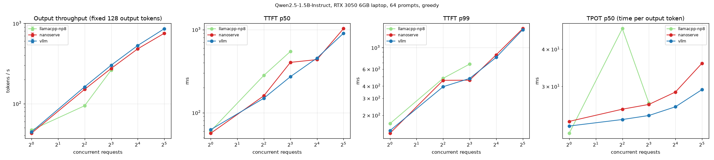
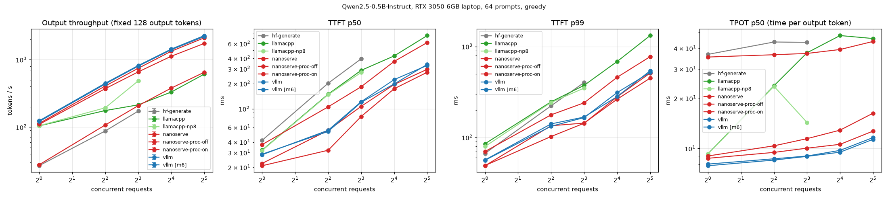
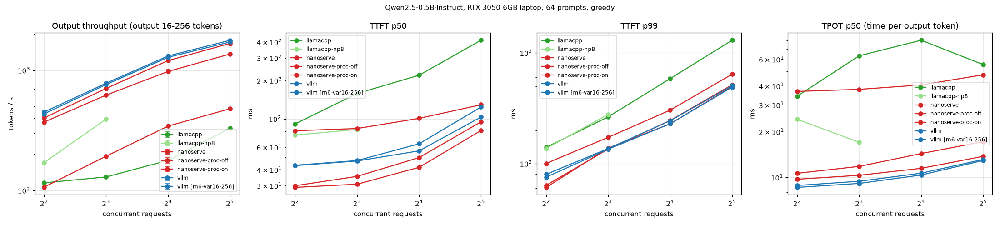

# nanoserve

A mini LLM inference engine built from scratch to learn ML infrastructure: **continuous batching**, a
**paged KV cache** with **prefix caching**, **Triton kernels** (paged attention + fused ops), **CUDA graphs**,
**chunked prefill**, **speculative decoding**, **sampling**, and an **OpenAI-compatible streaming server**
whose GPU loop runs in its own process. Benchmarked honestly against vLLM and llama.cpp, with every
stage gated on matching HuggingFace's outputs.

Development hardware: an RTX 3050 6 GB *laptop* GPU under WSL2, Qwen2.5-0.5B-Instruct and 1.5B-Instruct.
Everything is parameterised (`--model`, `--device`, KV budget, CUDA arch); the 3B benchmark on a rented GPU
is one script (`bench/runs/cloud_3b.sh`, not run yet).

**At a glance (same-session comparisons with vLLM 0.33.0):**

| | throughput vs vLLM | how it got there |
|---|---|---|
| Qwen2.5-0.5B | 23–30% (M6) → **89–94%** (M11) | CUDA graphs, chunked prefill, piecewise graphs, Triton fusion, engine process |
| Qwen2.5-1.5B | **88–96%** (M14) | same engine, bigger model: weights dominate, overheads matter less |
| shared 1,024-token prompt, 0.5B | **105–111% of vLLM** from c=8 (both with prefix caching) | M12 prefix caching: 2.4x vs no caching at c=32 |

## Results

Qwen2.5-0.5B-Instruct, bf16 (llama.cpp: f16 GGUF), 64 prompts, greedy, 3 repeats (median; plots show
min-max), every engine through the same OpenAI streaming client, all fairness checks passed (exact output
lengths, identical prompt token counts). **"nanoserve M11" = the final engine**: the GPU loop in its own
process (separate from the HTTP server), fused Triton kernels, CUDA-graph decode steps, piecewise CUDA
graphs for mixed prefill+decode steps, chunked prefill with a 2048-token step budget. It was measured in
the same session as the vLLM row, at every concurrency and on both workloads (vLLM within 3% of its M6
run). Other nanoserve rows are from earlier sessions.

**Fixed 128 output tokens — output tokens/s**

| engine | c=1 | c=4 | c=8 | c=16 | c=32 |
|---|---|---|---|---|---|
| HF `generate` (static padded batching, in-process) | 26.9 | 87.9 | 173.0 | – | – |
| nanoserve M6 (no CUDA graphs) | 27.8 | 107.8 | 208.4 | 379.9 | 652.1 |
| nanoserve M7 (CUDA graphs) | 94.5 | 314.1 | 553.8 | 943.4 | 1440.4 |
| nanoserve M8 (graphs + chunked prefill) | 94.8 | 314.9 | 554.1 | 947.8 | 1452.8 |
| nanoserve M9 (+ piecewise graphs) | 98.4 | 328.4 | 581.7 | 998.5 | 1547.9 |
| nanoserve M10 (+ fused Triton ops) | 110.5 | 376.6 | 666.3 | 1136.7 | 1769.2 |
| **nanoserve M11 (+ engine in its own process)** | **113.6** | **407.4** | **746.3** | **1334.7** | **2110.1** |
| llama.cpp b12247, 8 slots | 105.1 | 193.8 | 485.6 | – | – |
| llama.cpp b12247, 32 slots | 104.7 | 176.4 | 214.3 | 332.0 | 611.7 |
| vLLM 0.33.0 (M11 session) | 124.4 | 447.7 | 819.4 | 1437.2 | 2275.9 |
| **nanoserve M11 / vLLM** | **91%** | **91%** | **91%** | **93%** | **93%** |

**Time to first token (fixed 128 tokens) — p50 / p99, ms**

| engine | c=1 | c=4 | c=8 | c=16 | c=32 |
|---|---|---|---|---|---|
| nanoserve M7 (one big prefill step) | 36 / 64 | 96 / 183 | 155 / 221 | 341 / 405 | 606 / 739 |
| nanoserve M8 (chunked, 2048/step) | 36 / 64 | 85 / 188 | 173 / 231 | 246 / 355 | 354 / 667 |
| nanoserve M9 (+ piecewise graphs) | 26 / 63 | 59 / 169 | 162 / 197 | 243 / 312 | 355 / 634 |
| nanoserve M10 (+ fused Triton ops) | 22 / 50 | 52 / 117 | 112 / 167 | 185 / 308 | 336 / 502 |
| **nanoserve M11 (+ engine process)** | **21 / 49** | **32 / 103** | **81 / 143** | **174 / 280** | **273 / 511** |
| vLLM 0.33.0 (M11 session) | 28 / 57 | 55 / 141 | 122 / 168 | 223 / 282 | 330 / 541 |

**Varied output lengths (16–256 per request, seeded) — the realistic case**

| engine | c=4 | c=8 | c=16 | c=32 | TTFT p50 / p99 @ c=16 |
|---|---|---|---|---|---|
| nanoserve M6 | 106.5 | 192.5 | 343.1 | 478.8 | 101 / 304 ms |
| nanoserve M8 | 299.5 | 498.2 | 825.2 | 1120.2 | 75 / 314 ms |
| nanoserve M9 | 323.8 | 545.9 | 897.6 | 1227.3 | 49 / 288 ms |
| nanoserve M10 | 371.5 | 623.5 | 1023.7 | 1390.0 | 45 / 237 ms |
| **nanoserve M11** | **401.2** | **705.9** | **1204.4** | **1674.6** | **42 / 229 ms** |
| llama.cpp, 8 slots | 170.4 | 391.9 | – | – | – |
| llama.cpp, 32 slots | 115.6 | 129.3 | 177.9 | 330.0 | 220 / 585 ms |
| vLLM 0.33.0 (M11 session) | 449.1 | 781.0 | 1316.4 | 1778.3 | 64 / 244 ms |
| **nanoserve M11 / vLLM** | **89%** | **90%** | **91%** | **94%** | |

**Shared 1,024-token system prompt (prefix caching, M12)** — the same system prompt in front of all 64
prompts (1,235 prompt tokens on average), fixed 128 output tokens, prefix caching OFF vs ON for both
engines, one session. Output tokens/s and TTFT p50 / p99:

| c | nanoserve off | **nanoserve on** | vLLM off | vLLM on | TTFT nanoserve on | TTFT vLLM on |
|---|---|---|---|---|---|---|
| 1 | 88.6 | **95.7** | 127.5 | 104.3 | **23** / 47 ms | 39 / 86 ms |
| 4 | 294.4 | **356.2** | 371.3 | 362.0 | **46** / 125 ms | 60 / 80 ms |
| 8 | 480.3 | **734.0** | 612.5 | 663.4 | **52 / 111** ms | 87 / 136 ms |
| 16 | 707.4 | **1339.7** | 860.2 | 1278.0 | **127 / 221** ms | 136 / 261 ms |
| 32 | 921.8 | **2181.9** | 1018.7 | 2063.1 | 357 / 379 ms | **209 / 261** ms |

With a shared prefix, prefix caching is worth **2.4x** throughput at c=32 for nanoserve (and cuts p99 TTFT
from 2.8 s to 0.38 s); with it on, nanoserve is at 92-98% of vLLM up to c=4 and **ahead from c=8**
(105-111%). vLLM's median TTFT is better at c=32. Unexplained: vLLM got slower at c=1 with its cache on.

**Qwen2.5-1.5B-Instruct (M14)** — the same benchmark on a 3x bigger model, one session, KV budget 1 GiB
(weights take ~3.1 GB of the 6 GB). Output tokens/s:

*Fixed 128 output tokens*

| engine | c=1 | c=4 | c=8 | c=16 | c=32 |
|---|---|---|---|---|---|
| **nanoserve** | **42.8** | **150.6** | **274.6** | **481.9** | **753.1** |
| vLLM 0.33.0 | 44.4 | 162.0 | 301.3 | 530.4 | 858.1 |
| llama.cpp b12247, 8 slots | 46.8 | 94.1 | 261.8 | – | – |
| **nanoserve / vLLM** | **96%** | **93%** | **91%** | **91%** | **88%** |
| TTFT p50 / p99 (ms), nanoserve vs vLLM | 57/130 vs 62/139 | 160/459 vs 149/394 | 403/461 vs 271/480 | 435/843 vs 454/793 | 1029/1573 vs 904/1535 |
| TPOT p50 (ms), nanoserve vs vLLM | 22.9 vs 22.1 | 25.2 vs 23.2 | 26.1 vs 24.0 | 28.7 vs 25.6 | 35.9 vs 29.3 |

*Varied output lengths (16–256)*

| engine | c=4 | c=8 | c=16 | c=32 |
|---|---|---|---|---|
| **nanoserve** | **149.7** | **261.5** | **445.9** | **595.2** |
| vLLM 0.33.0 | 162.4 | 286.2 | 488.9 | 676.6 |
| llama.cpp b12247, 8 slots | 84.9 | 214.3 | – | – |
| **nanoserve / vLLM** | **92%** | **91%** | **91%** | **88%** |
| TTFT p50 / p99 (ms), nanoserve vs vLLM | 77/206 vs 100/191 | 89/355 vs 104/335 | 101/780 vs 113/617 | 262/1452 vs 223/1361 |
| TPOT p50 (ms), nanoserve vs vLLM | 26.1 vs 23.8 | 27.6 vs 25.1 | 31.0 vs 28.4 | 36.9 vs 33.4 |

On the bigger model nanoserve reaches **88–96% of vLLM**: each step is dominated by reading ~3.1 GB of
weights (≥ ~18 ms at ~168 GB/s), the same for both engines, so fixed per-step overheads matter less. vLLM's
time to first token is better under load on 1.5B (e.g. fixed c=8: 403 vs 271 ms p50).
**llama.cpp is the fastest of the three at c=1** (46.8 vs 42.8 tok/s; TPOT 20.9 vs 22.9 ms):
its single-stream decode path is tuned. With 8 slots it drops at c=4 (TPOT 47 ms), as on 0.5B.






**In one line:** on a 6 GB laptop GPU nanoserve reaches **89–94% of vLLM's throughput** (same session), with
a median time to first token below vLLM's at every load measured; it beats HF `generate` at every load and
llama.cpp's best configuration from c=8 up. Time per token is 8.7–13.8 ms vs vLLM's 7.9–12.9 ms.

## Architecture

```
 HTTP client ──SSE──▶ nanoserve/server.py (FastAPI)          /v1/completions, /v1/chat/completions
                         │  tokenize, validate, sampling params, incremental detokenize, abort on disconnect
                         ▼                   ── API process ──────────────────────────────────────────────
                 nanoserve/engine_process.py  (M11) pipe: requests in, ONE message of tokens per step out;
                         │                   a reader thread wakes each event loop once per step
                         ▼                   ── engine process (own GIL, owns the GPU) ────────────────────
                 nanoserve/engine.py  LLMEngine.step()   (one iteration = one forward pass)
                         │
     ┌───────────────────┼─────────────────────────────────────────────┐
     ▼                   ▼                                             ▼
 scheduler.py        kv_manager.py / kv_cache.py                   model.py  forward_batch()
 continuous batching  paged pool [blocks,16,kv_heads,dim]           Qwen2 from scratch (plain tensors)
 FCFS admission by    block tables, slot map; M12 prefix cache      selective batching: token-wise layers
 seats + token budget explicit KV budget; contiguous mode kept      over ALL tokens at once; attention per
 + KV blocks          for A/B comparison                            request:
 LIFO preemption with                                                 prefill / multi-token -> SDPA
 recompute                                                            decode -> kernels/paged_attention.py
                                                                      (Triton, 1 launch per layer)
                                                                   greedy argmax or seeded sampling (M13),
                                                                   1 GPU->CPU sync / step
                                                                   pure-decode steps: replay a CUDA graph
                                                                   (cuda_graphs.py, one per batch bucket)
                                                                   mixed steps <= 512 tokens: 25 graph
                                                                   pieces per token bucket, attention
                                                                   eager in between (piecewise)
                                                                   token-wise ops: fused Triton kernels
                                                                   (kernels/fused.py) + merged GEMMs
 speculative.py: 0.5B draft proposes k tokens, 1.5B target verifies k+1 in one pass, rewind caches
```

## Milestones and what each one showed

| | Milestone | Key result (laptop) |
|---|---|---|
| M0 | Benchmark harness first: closed-loop load, warmup, repeats, TTFT/TPOT/E2E p50/p99, fairness checks (exact output length, identical prompt tokens), HF/vLLM/llama.cpp adapters | baselines: HF 34 / vLLM 121 / llama.cpp 104 tok/s at c=1 |
| M1 | Own Qwen2 forward, contiguous KV cache, greedy loop | **bf16 logits bitwise equal to HF**; generation token-for-token equal; 1,012 kernel launches/step, GPU 37% busy |
| M2 | Selective batching + scheduler with static and continuous policies | varied lengths: continuous **+27-49% throughput, ~30x lower TTFT** than static; fixed lengths: equal (as theory says) |
| M3 | Paged KV cache, block tables, preemption by recompute | same 2 GiB budget: **85 -> 706 concurrent requests (8.3x)**, KV utilisation 11% -> 97%; costs 4-8% speed (gather) |
| M4 | Triton paged-attention decode kernel | per layer 14x faster at B=8, 35-81x at B=32; end-to-end **c=32: 221 -> 730 tok/s**; TPOT flat in concurrency |
| M5 | Speculative decoding (0.5B draft -> 1.5B target) | output **identical** to plain greedy; acceptance 53-67%; but **0.71-0.82x slower** here (draft costs 0.86x the target: both launch-bound) |
| M6 | OpenAI-compatible streaming server + full benchmark | 23–30% of vLLM; gap = a constant ~4x per-step cost (launch overhead) |
| M7 | CUDA-graph decode steps (one graph per batch bucket, static buffers, padding into a garbage block) | graph step **bitwise** = eager step; decode step **34 → 10 ms**; **65–78% of vLLM** |
| M7b | Graphs for speculative decoding: draft steps + verification as "one decode row per token" | speculative now **1.21x faster** at c=1 (k=2), was 0.71x; cost model predicted within ~4% |
| M8 | TTFT: profile, then chunked prefill + 2048-token step budget | TTFT under load was one giant synchronised prefill step; p50 at c=32 **606 → 354 ms** (vLLM 314), same throughput |
| M9 | Piecewise CUDA graphs for mixed prefill+decode steps (everything but attention graphed per token bucket); ITL metric | piecewise step **bitwise** = eager; small mixed step **37 → 13 ms**; TTFT p50 c=1 **34 → 26 ms**, c=4 91 → 59; varied lengths +3–7% tok/s; fixed a capture memory leak (−190 MiB) |
| M10 | Operator fusion in Triton (RMSNorm + residual add, RoPE + KV write, SiLU×mul) + merged QKV and gate/up GEMMs | kernels **bitwise** = the PyTorch ops; **1,052 → 325 kernels/step**; decode step 10.3 → 8.4 ms, 2048-token prefill 166 → 131 ms; **+14–16% tok/s at every load: 78–89% of vLLM** |
| M11 | Profile the loop under load, then move the engine into its own process (API server / engine core split) | scheduling was only 0.25 ms of a 14.9 ms step (GPU 95% busy) — the loss was GIL sharing with the HTTP thread (server −22% vs bare loop); tokens **bitwise** = in-thread engine; **+3% (c=1) to +21% (c=32): 89–94% of vLLM** |
| M12 | Automatic prefix caching: refcounted blocks, exact-prefix trie keys, LRU eviction | fp32 tokens identical with/without (also under eviction + preemption); shared 1,024-token prompt: **2.4x tok/s at c=32**, p99 TTFT 2.8 s → 0.38 s; **ahead of vLLM (also caching) from c=8** |
| M13 | Sampling: temperature / top-k / top-p, Gumbel-max, per-request seeded randomness | draws match exact softmax probabilities (20k-draw tests); a seed reproduces the same text whatever the batch and across preemption; temperature 0 = the old greedy path |
| M14 | Bigger model: Qwen2.5-1.5B on the laptop; 3B cloud script | fast path vs reference within the tie rule; **88–96% of vLLM**; beats llama.cpp (8 slots) at c=4, c=8; `cloud_3b.sh` ready for a rented GPU |

Full numbers, every failure and every judgment call: [`LOG.md`](LOG.md). Every term: [`GLOSSARY.md`](GLOSSARY.md).

## How correctness is gated

- **Bitwise vs HuggingFace (bf16) for a single request**: by performing floating-point operations in exactly
  HF's order (RMSNorm in fp32, cos/sin cast before rotation, SDPA with `enable_gqa`, LM head only on rows
  needed). Generation is token-for-token identical to HF `generate` on 8 prompts / 503 tokens.
- **fp32 strict gates** for everything that changes numerics (batching, paging, preemption, speculative
  decoding): token-for-token identical to the single-request path.
- **bf16 tie rule** where exact equality is impossible: batching changes matmul shapes and therefore
  rounding ("batch invariance"). A bf16 divergence is accepted only at a near-tie (reference top-2 logit
  gap <= 0.25, about one bf16 rounding step at these magnitudes); anything else fails.
- **Kernel**: Triton output vs a PyTorch oracle: fp32 <= 1e-5, bf16 <= 1e-2 (measured <= 4.5e-3), for
  the head layouts of 0.5B, 1.5B and 3B.
- **Graphs**: a CUDA-graph step at an exact bucket size gives logits **bitwise** equal to the eager step
  (pure-decode M7, and M9's mixed batch of a fresh prefill + a chunk on a cache + kernel decodes).
- **Fused kernels**: each one bitwise equal to the PyTorch ops it replaces (bf16, 2048-row inputs); fused
  vs unfused engine under the tie rule (merged GEMMs change accumulation order). The unfused path stays
  the HF-exact reference.
- **Engine process**: tokens **bitwise** identical to the same engine run as a thread (same kernels, same
  inputs), with EOS stopping, aborts freeing KV in the child, and errors crossing the process boundary.
- **Prefix caching**: with vs without, fp32 tokens identical on a shared-prefix workload, including under
  eviction and preemption, with no leaked blocks; bf16 fast path under the tie rule.
- **Sampling**: statistical tests against exact softmax probabilities (temperature, top-k, top-p); seeded
  output identical across runs, batch compositions and preemption + recompute.
- 183 tests (`uv run pytest`: 175, plus `uv run pytest -m spec`: 8 on the 1.5B model).

## Where we lose, and why (honest section)

1. **Launch overhead — the big one, now mostly fixed (M7).** Through M6 every decode step cost ~35 ms vs
   vLLM's ~8 ms: ~1,012 small kernels launched one by one from Python, GPU busy ~37% of the step (M1
   profile). M7 records each pure-decode step once as a **CUDA graph** per batch-size bucket and replays it
   with one launch: synchronous decode step **33.9 → 9.8 ms** (B=1), 33.8 → 10.6 (B=8), 32.9 → 12.3 (B=32);
   end to end 2.0–3.4x more throughput. Memory-bandwidth floor for 0.5B on this GPU: ~6 ms/step (estimate:
   ~0.99 GB of weights / ~168 GB/s, bandwidth not measured).
2. **What is left of the per-token gap (8.7–13.8 ms vs vLLM's 7.9–12.9 ms, ~10%).** M10 fused the
   token-wise ops by hand (Triton RMSNorm + residual add, RoPE + KV write, SiLU×mul; merged QKV and gate/up
   GEMMs): 1,052 → 325 kernels per decode step, graphed step 10.3 → 8.4 ms. 76–79% of a decode step is now
   GEMMs reading the weights, the floor without quantization. M11 removed the serving-layer loss: profiled
   at c=32, scheduling + input building + post-processing took only 0.25 ms of a 14.9 ms step (GPU 95%
   busy in the bare loop, 2,150 tok/s), but the HTTP server made only 1,681 tok/s because its thread
   shared Python's GIL with the engine thread. With the engine in its own process (vLLM v1's design) the
   server makes 2,110 tok/s at c=32. Left: mixed steps run attention eagerly between graph pieces, the LM
   head and argmax run outside the graph, and vLLM's kernels (FlashAttention / FlashInfer, torch.compile
   fusions) are faster per step.
3. **Mixed steps: graphed since M9 — what remains is compute.** Through M8 any step containing a prefill
   chunk ran eagerly (~37 ms instead of ~13). M9 graphs everything except attention, per token bucket
   ("piecewise", as vLLM does): a mixed step with a small chunk now costs ~13 ms; at 150–250 tokens 22–25
   ms, of which 18–20 ms is the graphs alone (real compute); at >= 512 tokens graphs don't help at all
   (0.99–1.06x, compute-bound), so they stop there. In the fixed-length benchmark, 32 prompts arrive
   together and are chunked at 2048 tokens, so ~99% of mixed steps are above 512 and piecewise changes
   little; with varied lengths it gives +3–9% throughput. M8's "surprise" (smaller budget -> worse TPOT
   p99) was partly a metric mismatch: vLLM's advice is about **ITL**, each gap between two tokens. A smaller
   budget does cut our worst gaps (ITL p99 154 -> 49 ms at c=32, budget 2048 -> 512) but cannot cut a
   request's MEAN gap (TPOT): the same prefill compute is only sliced into more, shorter interruptions.
4. **Time to first token: mostly closed (M8).** Profiling showed TTFT under load was ~100% one giant prefill
   step: 32 synchronised arrivals (~7k prompt tokens) prefilled at once, everyone waiting for all of it
   (queue wait 0 ms). Chunked prefill with a 2048-token budget (vLLM's own default on GPUs < 70 GB) spreads it
   over several steps: TTFT p50 at c=32 **606 → 354 ms** (vLLM 314) with no throughput loss. p99 barely
   moves (667 vs vLLM 494): the last requests of a burst still wait for the burst's total prefill compute,
   which is ~100% GPU-bound (GEMM 70%, unfused elementwise ops 23% of prefill GPU time).
5. **Speculative decoding: a modest, low-load win — and only after graphs.** It is lossless (output identical
   to the target). Without graphs it LOST (0.71x at k=4): the 0.5B draft cost 0.86x the 1.5B target because
   both were launch-bound. With graphs (draft 9.5 ms vs target 24.7 ms; verifying 5 tokens costs 1.07x one)
   it wins **1.21x at k=2, c=1** (TPOT 24.6 → 20.1 ms), 1.12x at k=4; at c=4 it is break-even (1.07x / 0.96x)
   because batching already shares the target's cost. A cost model predicted each number within ~4%
   (`bench/runs/m7b_costs.py`). Acceptance is only 53–67% for this draft/target pair, which caps the gain.
6. **llama.cpp depends on its configuration.** Its 8-slot config was 2.3x faster than nanoserve M6 at c=8;
   nanoserve M7 now beats it there (554 vs 486 tok/s; varied 504 vs 392). Its per-token cost drops when the
   slot count matches the load; ours needs no tuning.
7. **Not implemented:** graphs for steps above 512 tokens, fusing elementwise ops INTO the GEMMs,
   swap-to-CPU preemption, stop strings / penalties / logprobs, quantization, tensor parallelism, split-K
   decode for long contexts. An omitted `temperature` means greedy (OpenAI's default would be 1.0: chosen so
   the default is deterministic). Speculative decoding is greedy-only (sampling would need rejection
   sampling). Speculative engine: reserves KV for prompt + max_new up front (no preemption), fixed k (no
   adaptive lookahead), eager prefills.
8. **CUDA-graph caveats.** Decode: one graph per batch bucket (1, 2, 4, ..., 128). Mixed: 25 pieces per
   token bucket (every 16 tokens to 256, every 32 to 512) = 600 graphs. The server captures all of them
   before serving (~3–5 s, +16 MiB); the in-process engine captures lazily. Steps are padded up to their
   bucket; pure-decode batches above 128 and steps above 512 tokens run eagerly.
9. **Measurement caveats.** Laptop GPU shared with the Windows display; background Windows load moved our
   TPOT by up to 40% during development (24 → 35 ms), so every comparison above was re-measured in one
   session (controls in `LOG.md`). The NVIDIA Windows driver spills over-budget CUDA allocations into system
   RAM instead of failing, so capacity was measured against explicit KV budgets. llama.cpp runs f16 weights,
   the others bf16.

## Numbers worth remembering

- KV cache per token = layers × 2 (K,V) × kv_heads × head_dim × bytes: **12 KB** for Qwen2.5-0.5B, 28 KB for
  1.5B, 36 KB for 3B (bf16). vLLM's log confirms it: 2.25 GiB ↔ 196,992 tokens.
- Contiguous vs paged, same 2 GiB budget: **85 vs 706 concurrent requests**, KV utilisation 11% vs 97%.
- Decode attention per layer at 8 requests: **36.7 ms → 2.6 ms per step** (gather+SDPA loop → one Triton launch).
- Continuous vs static batching on varied lengths: **TTFT 3.4 s → 114 ms** at c=8.
- CUDA graphs: decode step **33.9 → 9.8 ms** at batch 1 (≈1,000 launches → 1 replay); nanoserve 23–30% → 65–78% of vLLM.
- Speculative decoding pays only if k × draft + verify < tokens accepted × target step: with graphs
  2 × 9.5 + 26.1 = 45 ms buys 2.28 tokens vs 24.7 ms for one → **1.21x** measured (1.25x predicted).
- TTFT under a burst = queue wait (0 ms here) + the admitting step; one 7k-token prefill step ≈ 600 ms on
  this GPU. Splitting it into 2048-token steps halves the median: **606 → 354 ms** at c=32.
- Piecewise graphs, one mixed step: 32 decodes + 32 prompt tokens **38 → 14 ms**; 32 + 480 tokens
  49 → 47 ms. Graphs remove launch overhead, not compute.
- TPOT is a request's MEAN token gap; ITL is EVERY gap. A smaller step budget shrinks the worst gap
  (ITL p99 154 → 49 ms) while the mean stays put.
- Serving layer at c=32: bare engine loop 2,150 tok/s, same engine behind an HTTP server in one process
  1,681 (−22%, GIL), engine in its own process **2,020–2,110**.
- Prefix caching with a shared 1,024-token prompt at c=32: **922 → 2,182 tok/s**, p99 TTFT 2,765 → 379 ms;
  the cache skips ~83% of each prompt's prefill.
- Fusion: **1,052 → 325 kernels** per decode step. Unfused RMSNorm/RoPE/SiLU moved ~7.4 GB per 2048-token
  prefill (≈ 46 ms at ~168 GB/s, measured 46); fused: −35 ms. End to end **+14–16% tok/s**.

## Reproduce

```bash
uv sync
uv run pytest                      # 175 tests (GPU + model download)
uv run pytest -m spec              # 8 tests on the 1.5B model (speculative decoding + fast path, ~11.5 GB RAM)

# in-process engine
uv run python -m bench.harness --backend nanoserve --concurrency 1,4,8,16,32 --kv-cache-gb 2

# HTTP server + any OpenAI-compatible benchmark client
uv run python -m nanoserve.server --port 8002 --kv-cache-gb 2
uv run python -m bench.harness --backend openai --engine-name nanoserve --base-url http://localhost:8002

# reference engines
bash bench/servers/vllm.sh                       # vLLM in its own venv (~/envs/vllm)
bash bench/servers/build_llamacpp.sh && bash bench/servers/llamacpp.sh

bash bench/runs/m11_bench.sh && uv run python -m bench.plot --tag m11-proc-on,m11-proc-off,m11-vllm-control,m6
bash bench/runs/m12_bench.sh                       # shared-prefix workload, prefix caching off/on, + vLLM
bash bench/runs/m14_1p5b.sh                        # 1.5B: nanoserve, vLLM, llama.cpp (ONLY=<engine> for one)
# sampling: POST /v1/completions with "temperature": 0.8, "top_p": 0.95, "seed": 1
uv run python -m bench.runs.m11_loop_profile       # step-loop phases + GPU busy time, bare vs AsyncEngine
uv run python -m bench.runs.m10_profile            # where GPU time goes, by kernel category
uv run python -m bench.runs.m10_step_probe         # one step: unfused vs fused
```

## Running on a cloud GPU (the 3B benchmark — not run yet)

Nothing is hard-coded to the laptop. On a rented Linux GPU with >= 24 GB (L4, A10, 4090, A100, H100), with
the CUDA toolkit, cmake and uv installed:

```bash
git clone https://github.com/darshanseenivasakumar/nanoserve.git ~/nanoserve && cd ~/nanoserve
CUDA_ARCH=89 bash bench/runs/cloud_3b.sh        # 89 = L4/4090, 80 = A100, 90 = H100
```
It runs the kernel tests on that GPU, installs vLLM, builds llama.cpp, downloads the 3B fp16 GGUF (two
parts: `qwen2.5-3b-instruct-fp16-0000{1,2}-of-00002.gguf`, verified on the Hugging Face API), then benchmarks
all three engines in one session (c = 1–64, fixed + varied) and plots the result. The kernel tests already cover 3B's head layout
(16 query / 2 KV heads, dim 128). Notes: on Linux an over-budget allocation OOMs normally (on this
Windows laptop the driver silently spills to system RAM, so capacity is measured against explicit budgets).
