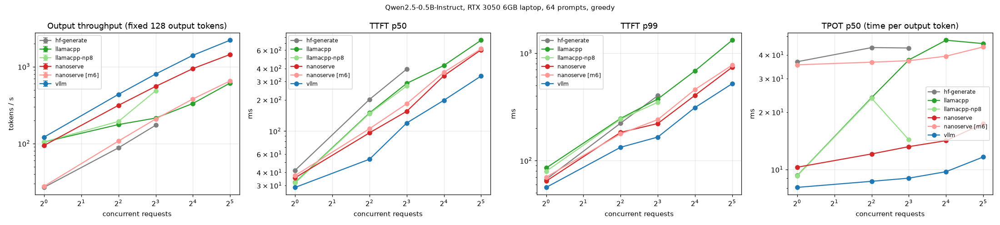
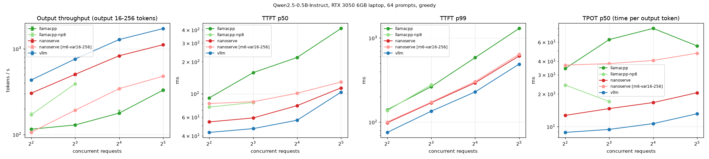

# nanoserve

A mini LLM inference engine built from scratch to learn ML infrastructure: **continuous batching**, a
**paged KV cache**, a **Triton paged-attention kernel**, **speculative decoding**, and an
**OpenAI-compatible streaming server**. Benchmarked honestly against vLLM and llama.cpp, with every
stage gated on matching HuggingFace's outputs.

Development hardware: an RTX 3050 6 GB *laptop* GPU under WSL2, Qwen2.5-0.5B-Instruct (and 1.5B for
speculative decoding). Everything is parameterised (`--model`, `--device`, KV budget, CUDA arch) so the
3B run on a cloud GPU is a flag change (see "Running on a cloud GPU").

## Results

Qwen2.5-0.5B-Instruct, bf16 (llama.cpp: f16 GGUF), 64 prompts, greedy, 3 repeats (median; plots show
min-max), every engine through the same OpenAI streaming client, all fairness checks passed (exact output
lengths, identical prompt token counts). "nanoserve (M7)" = final engine with CUDA-graph decode, measured
with a same-session vLLM control (121.1 / 798.5 / 2175.9 tok/s at c=1/8/32, within 2% of the M6 vLLM run).
Other rows are from the M6 session.

**Fixed 128 output tokens — output tokens/s**

| engine | c=1 | c=4 | c=8 | c=16 | c=32 |
|---|---|---|---|---|---|
| HF `generate` (static padded batching, in-process) | 26.9 | 87.9 | 173.0 | – | – |
| nanoserve M6 (no CUDA graphs) | 27.8 | 107.8 | 208.4 | 379.9 | 652.1 |
| **nanoserve M7 (CUDA graphs)** | **94.5** | **314.1** | **553.8** | **943.4** | **1440.4** |
| llama.cpp b12247, 8 slots | 105.1 | 193.8 | 485.6 | – | – |
| llama.cpp b12247, 32 slots | 104.7 | 176.4 | 214.3 | 332.0 | 611.7 |
| vLLM 0.33.0 | 121.1 | 436.3 | 802.4 | 1405.2 | 2208.1 |
| nanoserve M7 / vLLM | 78% | 72% | 69% | 67% | 65% |

**Varied output lengths (16–256 per request, seeded) — the realistic case**

| engine | c=4 | c=8 | c=16 | c=32 | TTFT p50 / p99 @ c=16 |
|---|---|---|---|---|---|
| nanoserve M6 | 106.5 | 192.5 | 343.1 | 478.8 | 101 / 304 ms |
| **nanoserve M7 (CUDA graphs)** | **304.1** | **504.3** | **830.2** | **1116.6** | 77 / 293 ms |
| llama.cpp, 8 slots | 170.4 | 391.9 | – | – | – |
| llama.cpp, 32 slots | 115.6 | 129.3 | 177.9 | 330.0 | 220 / 585 ms |
| vLLM 0.33.0 | 433.5 | 761.1 | 1282.8 | 1722.1 | 56 / 229 ms |




**In one line:** nanoserve reaches **65–78% of vLLM's throughput** on a 6 GB laptop GPU, beats HF
`generate` at every load and llama.cpp's best configuration from c=8 up; time per token is 10–17 ms vs
vLLM's 8–12 ms. The biggest remaining gap is **time to first token under load** (prefill, below).

## Architecture

```
 HTTP client ──SSE──▶ nanoserve/server.py (FastAPI)          /v1/completions, /v1/chat/completions
                         │  tokenize, validate (greedy only), incremental detokenize, abort on disconnect
                         ▼
                 nanoserve/async_engine.py   engine loop in a background thread; per-request asyncio
                         │                   queues; works across event loops
                         ▼
                 nanoserve/engine.py  LLMEngine.step()   (one iteration = one forward pass)
                         │
     ┌───────────────────┼─────────────────────────────────────────────┐
     ▼                   ▼                                             ▼
 scheduler.py        kv_manager.py / kv_cache.py                   model.py  forward_batch()
 continuous batching  paged pool [blocks,16,kv_heads,dim]           Qwen2 from scratch (plain tensors)
 FCFS admission by    block tables, free list, slot mapping         selective batching: token-wise layers
 seats + token budget explicit KV budget; contiguous mode kept      over ALL tokens at once; attention per
 + KV blocks          for A/B comparison                            request:
 LIFO preemption with                                                 prefill / multi-token -> SDPA
 recompute                                                            decode -> kernels/paged_attention.py
                                                                      (Triton, 1 launch per layer)
                                                                   greedy argmax, 1 GPU->CPU sync / step
                                                                   pure-decode steps: replay a CUDA graph
                                                                   (cuda_graphs.py, one per batch bucket)
 speculative.py: 0.5B draft proposes k tokens, 1.5B target verifies k+1 in one pass, rewind caches
```

## Milestones and what each one showed

| | Milestone | Key result (laptop) |
|---|---|---|
| M0 | Benchmark harness first: closed-loop load, warmup, repeats, TTFT/TPOT/E2E p50/p99, fairness checks (exact output length, identical prompt tokens), HF/vLLM/llama.cpp adapters | baselines: HF 34 / vLLM 121 / llama.cpp 104 tok/s at c=1 |
| M1 | Own Qwen2 forward, contiguous KV cache, greedy loop | **bf16 logits bitwise equal to HF**; generation token-for-token equal; 1,012 kernel launches/step, GPU 37% busy |
| M2 | Selective batching + scheduler with static and continuous policies | varied lengths: continuous **+27-49% throughput, ~30x lower TTFT** than static; fixed lengths: equal (as theory says) |
| M3 | Paged KV cache, block tables, preemption by recompute | same 2 GiB budget: **85 -> 706 concurrent requests (8.3x)**, KV utilisation 11% -> 97%; costs 4-8% speed (gather) |
| M4 | Triton paged-attention decode kernel | per layer 14x faster at B=8, 35-81x at B=32; end-to-end **c=32: 221 -> 730 tok/s**; TPOT flat in concurrency |
| M5 | Speculative decoding (0.5B draft -> 1.5B target) | output **identical** to plain greedy; acceptance 53-67%; but **0.71-0.82x slower** here (draft costs 0.86x the target: both launch-bound) |
| M6 | OpenAI-compatible streaming server + full benchmark | 23–30% of vLLM; gap = a constant ~4x per-step cost (launch overhead) |
| M7 | CUDA-graph decode steps (one graph per batch bucket, static buffers, padding into a garbage block) | graph step **bitwise** = eager step; decode step **34 → 10 ms**; **65–78% of vLLM** |

Full numbers, every failure and every judgment call: [`LOG.md`](LOG.md). Every term: [`GLOSSARY.md`](GLOSSARY.md).

## How correctness is gated

- **Bitwise vs HuggingFace (bf16) for a single request**: by performing floating-point operations in exactly
  HF's order (RMSNorm in fp32, cos/sin cast before rotation, SDPA with `enable_gqa`, LM head only on rows
  needed). Generation is token-for-token identical to HF `generate` on 8 prompts / 503 tokens.
- **fp32 strict gates** for everything that changes numerics (batching, paging, preemption, speculative
  decoding): token-for-token identical to the single-request path.
- **bf16 tie rule** where exact equality is impossible: batching changes matmul shapes and therefore
  rounding ("batch invariance"). A bf16 divergence is accepted only at a near-tie (reference top-2 logit
  gap <= 0.25, about one bf16 rounding step at these magnitudes); anything else fails.
- **Kernel**: Triton output vs a PyTorch oracle: fp32 <= 1e-5, bf16 <= 1e-2 (measured <= 4.5e-3), for
  the head layouts of 0.5B, 1.5B and 3B.
- 122 tests (`uv run pytest`: 117, plus `uv run pytest -m spec`: 5 speculative tests on the 1.5B model).

## Where we lose, and why (honest section)

1. **Launch overhead — the big one, now mostly fixed (M7).** Through M6 every decode step cost ~35 ms vs
   vLLM's ~8 ms: ~1,012 small kernels launched one by one from Python, GPU busy ~37% of the step (M1
   profile). M7 records each pure-decode step once as a **CUDA graph** per batch-size bucket and replays it
   with one launch: synchronous decode step **33.9 → 9.8 ms** (B=1), 33.8 → 10.6 (B=8), 32.9 → 12.3 (B=32);
   end to end 2.0–3.4x more throughput. Memory-bandwidth floor for 0.5B on this GPU: ~6 ms/step (estimate:
   ~0.99 GB of weights / ~168 GB/s, bandwidth not measured).
2. **What is left of the per-token gap (10–17 ms vs vLLM's 8–12 ms).** Per step we still build the batch in
   Python (scheduler, slot lists, block tables), copy inputs to the GPU, and argmax + `.tolist()` outside the
   graph; ops are not fused (vLLM uses torch.compile on top of its graphs); and the engine thread shares the
   GIL with the HTTP/tokenizer thread (vLLM v1 runs API server and engine core as separate processes). TPOT
   also grows a little with load (10 → 17 ms from c=1 to c=32; vLLM 8 → 12 ms).
3. **Time to first token under load — now the largest gap.** Prefills are not graphed and run one request at
   a time through SDPA, and there is no chunked prefill: TTFT p50 at c=32 is 606 ms vs vLLM's 335 ms, and a
   long prompt joining the batch stalls everyone's next token for that step.
4. **Speculative decoding lost (0.71x at k=4, measured before M7).** It is lossless (output identical to the
   target) and verifying 5 tokens costs only 1.3x one token — but the 0.5B draft cost 0.86x the 1.5B target
   per forward because both were launch-bound. The speculative engine does not use graphs yet; with a ~6 ms
   graphed draft the same acceptance predicts ~1.6x at c=1. Not re-measured.
5. **llama.cpp depends on its configuration.** Its 8-slot config was 2.3x faster than nanoserve M6 at c=8;
   nanoserve M7 now beats it there (554 vs 486 tok/s; varied 504 vs 392). Its per-token cost drops when the
   slot count matches the load; ours needs no tuning.
6. **Not implemented:** graphs for prefill, op fusion (torch.compile), chunked prefill, prefix caching,
   swap-to-CPU preemption, sampling (greedy only), quantization, tensor parallelism, split-K decode for long
   contexts. Speculative engine: reserves KV for prompt + max_new up front (no preemption), SDPA only, no graphs.
7. **CUDA-graph caveats.** One graph per bucket (1, 2, 4, 8, 16, 24, 32, 48, 64, 96, 128), captured lazily on
   first use (a one-off pause of ~1 s); batches between buckets are padded (5 requests run the 8-graph);
   batches above 128 or any step containing a prefill run eagerly.
8. **Measurement caveats.** Laptop GPU shared with the Windows display; background Windows load moved our
   TPOT by up to 40% during development (24 → 35 ms), so every comparison above was re-measured in one
   session (controls in `LOG.md`). The NVIDIA Windows driver spills over-budget CUDA allocations into system
   RAM instead of failing, so capacity was measured against explicit KV budgets. llama.cpp runs f16 weights,
   the others bf16.

## Numbers worth remembering

- KV cache per token = layers × 2 (K,V) × kv_heads × head_dim × bytes: **12 KB** for Qwen2.5-0.5B, 28 KB for
  1.5B, 36 KB for 3B (bf16). vLLM's log confirms it: 2.25 GiB ↔ 196,992 tokens.
- Contiguous vs paged, same 2 GiB budget: **85 vs 706 concurrent requests**, KV utilisation 11% vs 97%.
- Decode attention per layer at 8 requests: **36.7 ms → 2.6 ms per step** (gather+SDPA loop → one Triton launch).
- Continuous vs static batching on varied lengths: **TTFT 3.4 s → 114 ms** at c=8.
- CUDA graphs: decode step **33.9 → 9.8 ms** at batch 1 (≈1,000 launches → 1 replay); nanoserve 23–30% → 65–78% of vLLM.

## Reproduce

```bash
uv sync
uv run pytest                      # 117 tests (GPU + model download)
uv run pytest -m spec              # 5 speculative-decoding tests (1.5B model, ~8 GB RAM)

# in-process engine
uv run python -m bench.harness --backend nanoserve --concurrency 1,4,8,16,32 --kv-cache-gb 2

# HTTP server + any OpenAI-compatible benchmark client
uv run python -m nanoserve.server --port 8002 --kv-cache-gb 2
uv run python -m bench.harness --backend openai --engine-name nanoserve --base-url http://localhost:8002

# reference engines
bash bench/servers/vllm.sh                       # vLLM in its own venv (~/envs/vllm)
bash bench/servers/build_llamacpp.sh && bash bench/servers/llamacpp.sh

bash bench/runs/m6_bench.sh && uv run python -m bench.plot --tag m6
```

## Running on a cloud GPU (the 3B benchmark)

Nothing is hard-coded to the laptop. On a Linux box with a bigger GPU:

```bash
MODEL=Qwen/Qwen2.5-3B-Instruct
uv run python -m nanoserve.server --model $MODEL --kv-cache-gb 20 --max-num-seqs 256 --port 8002
MODEL=$MODEL GPU_UTIL=0.9 bash bench/servers/vllm.sh
CUDA_ARCH=90 bash bench/servers/build_llamacpp.sh      # 89 for L4/4090, 90 for H100
GGUF_REPO=Qwen/Qwen2.5-3B-Instruct-GGUF GGUF_FILE=qwen2.5-3b-instruct-fp16.gguf bash bench/servers/build_llamacpp.sh
```
(⚠ not verified: check the exact fp16 GGUF filename in that repo first — larger GGUFs are sometimes split
into parts, in which case point llama-server at the first part.)
then run the harness with `--model $MODEL`. The kernel tests already cover 3B's head layout
(16 query / 2 KV heads, dim 128). Notes: on Linux an over-budget allocation OOMs normally (on this
Windows laptop the driver silently spills to system RAM, so capacity is measured against explicit budgets).
